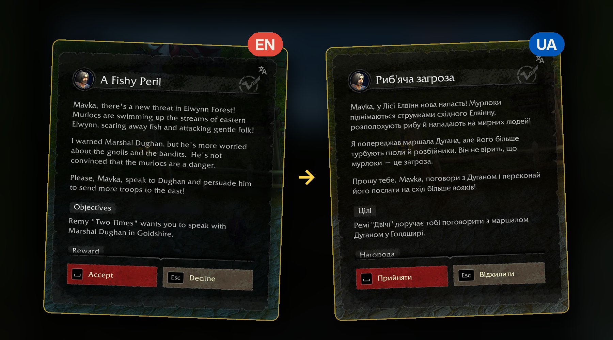

# Dialogue UI - UALL

[Українською](README.uk.md)

A World of Warcraft: Forever addon: [Dialogue UI](https://www.curseforge.com/wow/addons/dialogueui)'s quest and
NPC window in Ukrainian, with the translations of
[UALL Forever](https://www.curseforge.com/wow/addons/uall-forever-ukrainian-localization).

UALL Forever translates the game's own quest and NPC windows; Dialogue UI replaces those windows with its own,
so with both enabled the quest window stayed in English. This small bridge addon brings UALL Forever's
Ukrainian text into Dialogue UI. It has no translations of its own: every word comes from UALL Forever, and
what UALL Forever doesn't have stays English.

[▶ Video (Ukrainian, 18 s)](docs/media/short-ua.mp4) · [longer explainer (53 s)](docs/media/promo-ua.mp4)

## Install

**One click (recommended):** [install with the CurseForge app](https://www.curseforge.com/wow/addons/dialogue-ui-uall/install).
The app installs Dialogue UI and UALL Forever along with it.

Ukrainian quest voiceover, optional: [UALL Forever: Ukrainian quest voiceover](https://www.curseforge.com/wow/addons/uall-forever-ukrainian-quest-voiceover-levels-140/install)
(the app adds Forever Voiceover by itself).

**Manual:** a manual download doesn't include the other two, so get all three (Dialogue UI, UALL Forever, this
addon) and put the folders into `World of Warcraft\_forever_\Interface\AddOns\`. `install.bat` copies this one.

Nothing to set up: log in and talk to an NPC, and the window is already in Ukrainian. The commands are only for
checking a problem: `/duall` (status), `/duall test` (with a quest window open).

## What is translated

- Quest title, description, objectives, progress and completion (through Dialogue UI's official translator
  API), Ukrainian only by default.
- What the NPC says, reply options, quest names in the NPC's list, the NPC's name, buttons, section headers and
  reward labels.
- UALL Forever's settings apply: parts switched off there stay English here; its original-text key and its
  reversed mode work as usual.

Stays English: whatever UALL Forever has no text for (e.g. the "Trivial" tag), progress-screen objective
counters, reward item names, and a bottom-button label that wouldn't fit on one line.

## How it works

UALL Forever doesn't share its translations with other addons; it rewrites the text of the game's own windows
(hidden while Dialogue UI is on). When Dialogue UI is about to draw a text, this addon briefly writes the English
into such a hidden text field, takes the Ukrainian line UALL Forever puts there and restores the field, all
before anything appears on screen. Quest text goes through Dialogue UI's translator API; the rest of the window
is swapped just before Dialogue UI lays it out. Details: the headers of
[`Core.lua`](DialogueUI_UALL/Core.lua) and [`Window.lua`](DialogueUI_UALL/Window.lua),
[`docs/research-dui-hooks.md`](docs/research-dui-hooks.md), [`docs/research-uallf-oracles.md`](docs/research-uallf-oracles.md).

## Repository

- `DialogueUI_UALL/`: the addon (what ships).
- `docs/`: in-game test steps (`TESTING.md`), publishing (`UPLOAD.md`, `curseforge-description.md`,
  `PUBLIC-CHECKLIST.md`), research notes, logo sources, media.
- `tools/make_zip.py`: builds the CurseForge zip into `dist/`. `.pkgmeta`: BigWigs packager config;
  `.github/workflows/release.yml` uploads a tagged release.
- `install.bat`: copies the addon into a WoW client (other clients get their interface number added to the
  installed copy, for testing).

Bugs in showing the text: [open an issue](../../issues). Mistakes in the translation itself: the UALL team
(their Discord is linked on the UALL Forever page).

## Credits

- [Dialogue UI](https://www.curseforge.com/wow/addons/dialogueui) by Peterodox (with Raenore): the window this
  addon translates, through its public translator API.
- [UALL Forever](https://www.curseforge.com/wow/addons/uall-forever-ukrainian-localization) by the UALL Forever
  team (Pekelnyj, ne_multik): every Ukrainian word shown.
- No code, art or text of either addon is included here; both are "All Rights Reserved" by their authors.

Unofficial: not affiliated with or endorsed by Blizzard Entertainment, the Dialogue UI authors or the UALL team.
World of Warcraft and Warcraft are trademarks or registered trademarks of Blizzard Entertainment, Inc. in the
U.S. and/or other countries.

MIT license. If you'd like to support the author:
[Patreon](https://www.patreon.com/hotbar) (optional, nothing is locked behind it).
