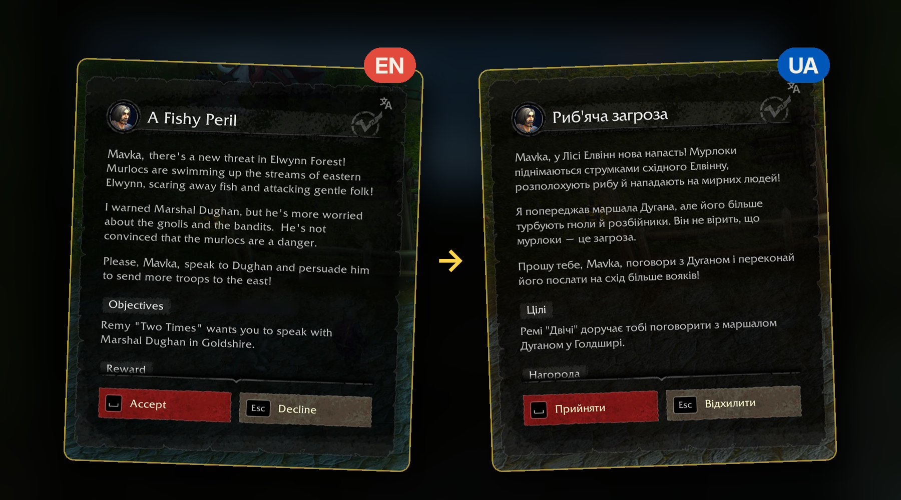

# Dialogue UI - UALL

[English](README.md)

Аддон для World of Warcraft: Forever: вікно завдань і розмов
[Dialogue UI](https://www.curseforge.com/wow/addons/dialogueui) українською, з перекладами
[UALL Forever](https://www.curseforge.com/wow/addons/uall-forever-ukrainian-localization).

UALL Forever перекладає стандартні вікна завдань і розмов гри; Dialogue UI замінює їх своїм вікном, тож коли
стояли обидва аддони, усе лишалося англійською. Цей невеликий аддон-місток переносить переклад UALL Forever у
вікно Dialogue UI. Власних перекладів у ньому немає: кожне слово — з UALL Forever, а чого там немає, те
лишається англійською.

[▶ Відео (українською, 19 с)](docs/media/short-ua.mp4) · [докладніше (53 с)](docs/media/promo-ua.mp4)

## Встановлення

**Одним кліком (рекомендовано):** [встановити через застосунок CurseForge](https://www.curseforge.com/wow/addons/dialogue-ui-uall/install).
Застосунок сам доставить Dialogue UI та UALL Forever.

Українська озвучка завдань, за бажанням: [UALL Forever: українська озвучка завдань](https://www.curseforge.com/wow/addons/uall-forever-ukrainian-quest-voiceover-levels-140/install)
(Forever Voiceover застосунок додасть сам).

**Вручну:** ручне завантаження не містить двох інших аддонів, тож завантажте всі три (Dialogue UI, UALL Forever і
цей) і покладіть теки в `World of Warcraft\_forever_\Interface\AddOns\`. Цей аддон копіює `install.bat`.

Налаштовувати нічого не треба: увійдіть у гру й поговоріть з NPC — вікно вже українською. Команди потрібні лише
для перевірки, якщо щось не так: `/duall` (стан), `/duall test` (з відкритим вікном завдання).

## Що перекладається

- Назва, опис, цілі, прогрес і завершення завдання (через офіційний API Dialogue UI для аддонів-перекладачів),
  типово лише українською.
- Репліки NPC, варіанти відповіді, назви завдань у списку NPC, ім'я NPC, кнопки, заголовки розділів і підписи
  нагород.
- Налаштування UALL Forever діють і тут: що вимкнено там, лишається англійською й тут; працюють і клавіша показу
  оригіналу, і обернений режим.

Лишається англійською: те, чого немає в UALL Forever (наприклад, позначка «Trivial»), лічильники цілей на екрані
прогресу, назви предметів-нагород і написи нижніх кнопок, що не вміщаються в один рядок.

## Як це працює

UALL Forever не відкриває свої переклади іншим аддонам: він підміняє текст у стандартних вікнах гри (поки
ввімкнено Dialogue UI, вони сховані). Коли Dialogue UI ось-ось покаже текст, аддон на мить пише англійський рядок
у таке сховане поле, забирає український, який туди ставить UALL Forever, і відновлює поле — усе це ще до того,
як щось з'явиться на екрані. Текст завдань іде через API Dialogue UI для перекладачів; решту вікна аддон
підміняє перед тим, як Dialogue UI розмістить його елементи.

Про помилки показу пишіть [в issues](../../issues), про помилки в самому перекладі — команді UALL (посилання
на їхній Discord — на сторінці UALL Forever).

## Подяки

- [Dialogue UI](https://www.curseforge.com/wow/addons/dialogueui) — Peterodox (за участі Raenore): вікно, яке
  перекладає цей аддон, через його публічний API для перекладачів.
- [UALL Forever](https://www.curseforge.com/wow/addons/uall-forever-ukrainian-localization) — команда UALL
  Forever (Pekelnyj, ne_multik): кожне українське слово.
- Коду, графіки чи текстів цих аддонів тут немає; обидва — «All Rights Reserved» їхніх авторів.

Неофіційний: не пов'язаний з Blizzard Entertainment, авторами Dialogue UI чи командою UALL і не схвалений ними.
World of Warcraft і Warcraft є торговими марками або зареєстрованими торговими марками Blizzard Entertainment,
Inc. у США та/або інших країнах.

Ліцензія MIT. Підтримати автора можна на
[Patreon](https://www.patreon.com/hotbar) (за бажанням, нічого не закрито за підпискою).
