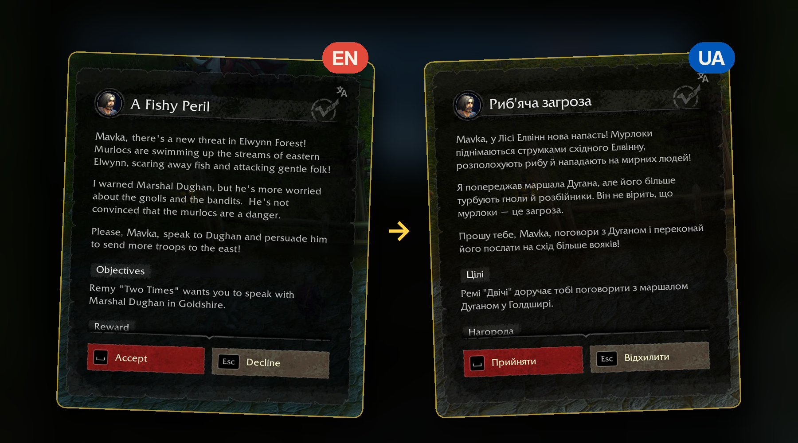

# Dialogue UI - UALL

**Dialogue UI's quest and NPC window in Ukrainian, with UALL Forever's translations.**
**Вікно завдань і розмов Dialogue UI українською — з перекладами UALL Forever.** Українською — нижче ↓

**Install everything in one click:** [install with the CurseForge app](https://www.curseforge.com/wow/addons/dialogue-ui-uall/install).
The app also installs [Dialogue UI](https://www.curseforge.com/wow/addons/dialogueui) and
[UALL Forever](https://www.curseforge.com/wow/addons/uall-forever-ukrainian-localization) for you.

Want the quests voiced in Ukrainian too? Add
[UALL Forever: Ukrainian quest voiceover](https://www.curseforge.com/wow/addons/uall-forever-ukrainian-quest-voiceover-levels-140/install)
(the app adds Forever Voiceover by itself).

UALL Forever translates the game's own quest and NPC windows. Dialogue UI replaces those windows with its own,
so with both enabled, the quest window stayed in English. This small bridge addon brings UALL Forever's Ukrainian
text into Dialogue UI. It adds no translations of its own: every word you see comes from UALL Forever, so the
wording is exactly UALL's.

## What you get

- Quest title, description, objectives, progress and completion text in Ukrainian, with your character's name,
  class and race filled in as in UALL Forever.
- What the NPC says, your reply options, the quest names in the NPC's list and the NPC's name.
- Buttons ("Accept", "Decline", "Continue", "Complete Quest", "Goodbye"…), section headers (Objectives, Rewards,
  Requirements) and reward labels.
- Ukrainian only: the English quest text is hidden. Dialogue UI's translator button (top right of the window):
  left click switches the quest text between Ukrainian and English, right click also shows the English
  paragraphs next to the Ukrainian ones.
- UALL Forever's settings apply: whatever is switched off there (quest text, NPC talk, interface labels, the
  whole translation) stays English here. In UALL Forever's reversed mode the window opens in English unless you
  hold its original-text key (Shift by default); in normal mode, holding that key opens it in English.
- Works with UALL Forever's Ukrainian quest voiceover (via Forever Voiceover) if you have it.

## What stays English

- Anything UALL Forever has no translation for (for example the "Trivial" tag on low-level quests). We don't
  invent our own words.
- Objective counters on the progress screen and reward item names.
- A button label that wouldn't fit on one line (the window's bottom buttons are narrow).

## Requirements

- [Dialogue UI](https://www.curseforge.com/wow/addons/dialogueui) (Forever version)
- [UALL Forever](https://www.curseforge.com/wow/addons/uall-forever-ukrainian-localization)

The CurseForge app installs both automatically. A manual download doesn't include them.

Nothing to set up: log in and talk to an NPC, and the window is already in Ukrainian.

## Commands (only for checking a problem)

- `/duall`: status (is Dialogue UI connected, is UALL Forever loaded, last translated quest).
- `/duall test`: checks the quest that is open right now.

## How it works (for the curious)

UALL Forever doesn't share its translations with other addons; it rewrites the text of the game's own windows
(hidden while Dialogue UI is on). When Dialogue UI is about to draw a text, this addon briefly writes the English
into such a hidden text field, takes the Ukrainian line UALL Forever puts there and restores the field, before
anything appears on screen. Quest text goes to Dialogue UI through its official translator API; the rest of the
window is swapped just before Dialogue UI lays it out, so long Ukrainian lines fit. If a Dialogue UI update
changes its internals, those parts simply stay English. No game files are changed, and no code from either
addon is copied.

Please report translation mistakes to the UALL team (their Discord is linked on the UALL Forever page), and
display problems in Dialogue UI here, in the comments.

Credits: [Dialogue UI](https://www.curseforge.com/wow/addons/dialogueui) by Peterodox (with Raenore);
[UALL Forever](https://www.curseforge.com/wow/addons/uall-forever-ukrainian-localization) by the UALL Forever team
(Pekelnyj, ne_multik). Unofficial: not affiliated with or endorsed by the Dialogue UI authors, the UALL team or
Blizzard Entertainment.

---

# Dialogue UI - UALL (українською)

**Вікно завдань і розмов Dialogue UI українською — з перекладами UALL Forever.**

**Встановити все одним кліком:** [через застосунок CurseForge](https://www.curseforge.com/wow/addons/dialogue-ui-uall/install).
Застосунок сам доставить [Dialogue UI](https://www.curseforge.com/wow/addons/dialogueui) та
[UALL Forever](https://www.curseforge.com/wow/addons/uall-forever-ukrainian-localization).

Хочете ще й чути завдання українською? Додайте
[UALL Forever: українську озвучку завдань](https://www.curseforge.com/wow/addons/uall-forever-ukrainian-quest-voiceover-levels-140/install)
(Forever Voiceover застосунок додасть сам).

UALL Forever перекладає стандартні вікна завдань і розмов гри. Dialogue UI замінює їх своїм вікном, тож коли
стояли обидва аддони, усе лишалося англійською. Цей невеликий аддон-місток переносить переклад UALL Forever у
вікно Dialogue UI. Власних перекладів у ньому немає: кожне слово — з UALL Forever, тож формулювання точнісінько
як в UALL Forever.

## Що ви отримаєте

- Назву, опис, цілі, прогрес і завершення завдання українською, з ім'ям, класом і расою вашого персонажа, як в
  UALL Forever.
- Репліки NPC, варіанти відповіді, назви завдань у списку NPC та ім'я NPC.
- Кнопки («Прийняти», «Відхилити», «Продовжити», «Завершити завдання», «Прощавай» тощо), заголовки розділів
  («Цілі», «Нагороди», «Вимоги») і підписи нагород.
- Лише українською: англійський текст завдання приховано. Кнопка перекладача Dialogue UI (угорі праворуч): лівий
  клік перемикає текст завдання між українською й англійською, правий показує ще й англійські абзаци поруч з
  українськими, якщо захочете бачити обидві мови.
- Налаштування UALL Forever діють і тут: що вимкнено там (текст завдань, розмови, написи інтерфейсу, весь
  переклад), те й тут англійською. В оберненому режимі UALL Forever вікно відкривається англійською, якщо не
  тримати клавішу показу оригіналу (типово Shift); у звичайному режимі — навпаки: з утриманою клавішею вікно
  відкриється англійською.
- Працює й з українською озвучкою UALL Forever (через Forever Voiceover), якщо вона встановлена.

## Що лишається англійською

- Те, чого немає в UALL Forever (наприклад, позначка «Trivial» біля легких завдань). Власних слів ми не
  вигадуємо.
- Лічильники цілей на екрані прогресу й назви предметів-нагород.
- Напис кнопки, що не вміщається в один рядок (нижні кнопки вікна вузькі).

## Потрібні аддони

- [Dialogue UI](https://www.curseforge.com/wow/addons/dialogueui) (версія для Forever)
- [UALL Forever](https://www.curseforge.com/wow/addons/uall-forever-ukrainian-localization)

Застосунок CurseForge встановить обидва сам. Ручне завантаження їх не містить.

Налаштовувати нічого не треба: увійдіть у гру й поговоріть з NPC — вікно вже українською.

## Команди (лише для перевірки, якщо щось не так)

- `/duall`: стан (чи підключено Dialogue UI, чи завантажено UALL Forever, останнє перекладене завдання).
- `/duall test`: перевіряє завдання, відкрите зараз у вікні.

Про помилки в самих перекладах пишіть команді UALL (посилання на Discord — на сторінці UALL Forever на
CurseForge); про помилки показу в Dialogue UI — сюди, у коментарі.

Подяки: [Dialogue UI](https://www.curseforge.com/wow/addons/dialogueui) — Peterodox (за участі Raenore);
[UALL Forever](https://www.curseforge.com/wow/addons/uall-forever-ukrainian-localization) — команда UALL Forever
(Pekelnyj, ne_multik). Неофіційний: не пов'язаний з авторами Dialogue UI, командою UALL чи Blizzard Entertainment
і не схвалений ними.

---

World of Warcraft and Warcraft are trademarks or registered trademarks of Blizzard Entertainment, Inc. in the
U.S. and/or other countries.

Like it? You can support the author on
[Patreon](https://www.patreon.com/hotbar) (optional, nothing is locked).
Сподобався? Підтримати автора можна на
[Patreon](https://www.patreon.com/hotbar) (за бажанням, нічого не закрито).
